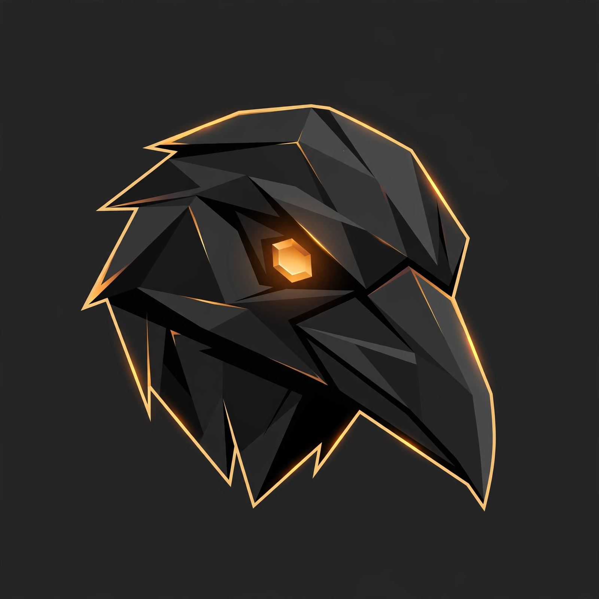
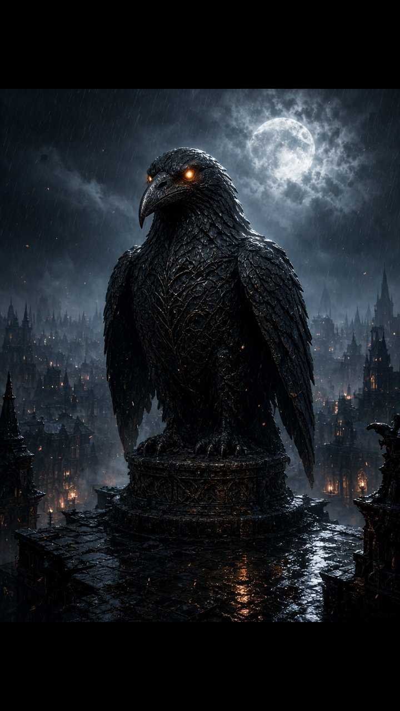
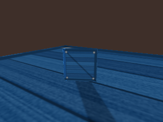
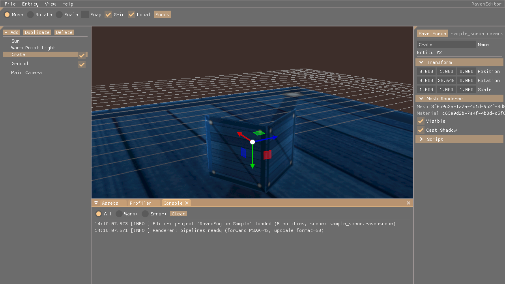

<p align="center">
  
</p>

<h1 align="center">RavenEngine</h1>

<p align="center">
  <em>A low-resource-focused C++20 Vulkan game engine — AAA ambitions on everyday hardware.</em><br>
  
  
  
</p>

<p align="center"><br>
<em>RavenEngine splash artwork (concept). In-splash-screen wiring is pending engine startup UI work.</em></p>

---

## What it is

RavenEngine is a **low-resource-focused C++20 Vulkan game engine and editor** targeting
integrated GPUs: no bloat, deterministic engine services, and a renderer that keeps frame
budgets tight.

Design goal, in one line: **a AAA look at 1920×1080 and 2560×1440, 60/120 FPS** — via render
scale, tiered quality, distance LOD and aggressive budget discipline, not by demanding 4K
enthusiast hardware.

## Current state — rendered by the engine, not concept art

<table>
<tr>
<td align="center"></td>
<td>
  <strong>Live render, right now.</strong><br>
  The sample scene drawn by <code>raven_render</code> on a Vulkan 1.3 device with dynamic
  rendering + synchronization2: PBR-ish forward pass, one directional shadow (1024²),
  warm point light, tangent-space normal map.<br><br>
  Captured locally on <strong>SwiftShader</strong> (Google's CPU Vulkan) — the same path
  CI runs on Linux with Lavapipe.
</td>
</tr>
</table>

<p align="center"><br>
<em>Orbit of the sample scene — 24 frames captured offscreen by the engine itself (SwiftShader, CPU Vulkan). This is the current look: working forward renderer, real shadows, real assets. It is also genuinely far from the target aesthetic — see below.</em></p>

## `ravened` — the editor, running

<table>
<tr>
<td align="center"></td>
<td>
  <strong>RavenEditor, for real.</strong><br>
  The dockspace's central node is a transparent hole: the 3D scene renders behind the UI
  (grid, PBR crate, directional shadow) and the panels — Hierarchy, Inspector (transform /
  mesh renderer / script / LOD / resource-mode material & texture editors), Assets browser,
  per-pass Profiler with GPU timings, a Logger-backed Console, Workspaces and History —
  edit the project live. The gizmo (W/E/R = move/rotate/scale,
  local/world, snap) manipulates the selection through ImGuizmo; orbit/pan/dolly with the
  mouse, F frames selection, Ctrl+S saves, Ctrl+D duplicates, Del deletes, Ctrl+Z/Y undo/redo.<br><br>
  (Screenshot from an earlier build — the tree has since added workspaces, the history
  panel, resource-mode inspectors and the texture remap dialog; the capture is refreshed by
  CI when the editor changes.)
  Captured by <code>ravened --headless --frames 3 --capture editor-screenshot.png</code> on
  SwiftShader (CI does the same on Lavapipe and uploads the capture as an artifact).
</td>
</tr>
</table>

## Target aesthetic — concept art, not engine output

<p align="center">
  
  
</p>
<p align="center"><em>The look RavenEngine is engineering toward (AI concept art). Achieving it needs the feature roadmap below — it is not what the engine renders today.</em></p>

## What's implemented (and tested)

- **C++20 + Vulkan 1.3** — dynamic rendering, synchronization2; no legacy paths.
- **Render graph** — passes declare reads/writes; validation rejects forward-referenced resources; barriers solved for you.
- **ECS** — sparse-set world, stable entity handles, views, hierarchy.
- **Asset pipeline** — UUID-addressed assets, `.meta` sidecars, import settings (sRGB/mipmaps/maxSize/BCn), deterministic DB rescan and issue reporting; OBJ/texture/material/audio importers; `FileWatcher` → `AssetChangedSignal` hot reload; async reimport toast with per-UUID folding; import-time **BCn compression (BC7/BC5/BC1, bc7enc_rdo)** with `.bc7` artifacts (`<Library>/bc7/<uuid>.bc7`); sample project included.
- **Scene format** — JSON scenes; schema v3 with UUIDs for every entity (v1/v2 load + migration tested), hierarchy, LOD serialization.
- **Renderer** — forward PBR-ish shading, PCF shadows, offscreen target, swapchain present, ImGui texture hooks ready, frame stats with per-pass GPU timings.
- **Camera**, **rigid-body physics**, **Lua 5.4 scripting**, **miniaudio** 3D audio, **ImGui (docking) + ImGuizmo** vendored for the editor.
- **Editor (`ravened`)** — docking layout + named **workspaces** (save/restore/reset), two-phase launcher, Hierarchy (multi-select, drag-drop instantiate), registry-driven Inspector with multi-edit and **resource mode** for material/texture assets (`.rmat` and `.meta` importSettings editing — undoable), Project panel (tree/grid/list, search, disk-cached rendered thumbnails, context menus, inline rename), texture remap dialog for smart import, History panel (click-to-time-travel), command-stack undo/redo everywhere (gizmo-drag coalescing), Console with channels, Profiler with GPU timings.
- **Engine services** — EventBus, channelled `raven::Logger` (spdlog backend), MemoryTracker, LinearAllocator, StackTrace, JobSystem worker threads, Tracy zones (off by default), scene v3 UUID round-trips.
- **Quality tiers** (`Quality.h`) — Low/Medium/High/Ultra presets (render scale, shadow size, MSAA, texture/aniso caps, light/particle/voice budgets, physics tick + sleep distance, LOD bias) with a unit-tested LOD projection model.
- **CI** — Linux (Lavapipe offscreen render + CycloneDX SBOM artifact), Windows (MSVC), macOS (MoltenVK), all green; `v0.1.0` tagged; binary snapshot in `dist/`.

Tests: **153 passing** locally without a Vulkan device (same suites; CI additionally builds and runs 1 Vulkan smoke test on Lavapipe).

## What's *not* done yet (the honest list)

Shipped and tested: SSAO/SSR/TAA/bloom/upscale are real GPU passes with per-tier gates (MSAA/SSAO/TAA/SSR/bloom/upscale), not just a cost model; LOD selection is implemented, unit-tested, serialized in scenes and consumed by the draw path; render-scale upscaling is the supported path (no vendored FSR/DLSS). Still missing, in rough priority order:

- **Model import via assimp** — submodule pinned (v6.0.6, `RAVEN_USE_ASSIMP=ON`), importer not implemented yet: no glTF/FBX hierarchy, cameras or lights, and the texture remap dialog's decisions are not yet consumed. This blocks Phase 3's acceptance flow (drop a glTF → remap → watch it render).
- **BCn artifacts have no renderer consumer yet** — the encoder writes `<Library>/bc7/*.bc7` on import, but upload into `VK_FORMAT_BC*` images on a transfer queue is not implemented; BC formats are unverified on any GPU.
- **Material graph** — node editor → Slang codegen with live recompile and exposed parameters; the material/texture resource inspectors landed, everything else (shader/model/font/scene viewers) is Phase 6.
- **GPU/renderer** — bindless 16k-texture array + buffer device addresses, GPU-driven culling, async compute, SVGF denoising, volumetric fog, GTAO, split-sum IBL, TAA + specular AA. None of these exist.
- **Architecture** — fiber job system (today's JobSystem is worker threads), pipelined frames (Game N / Render N−1 / GPU N−2), tagged page allocators (Onion/Garlic).
- **Jolt Physics** is vendored and builds with `RAVEN_BUILD_JOLT=ON`; the sample and physics tests use the built-in minimal solver today.
- **Nsight Aftermath** hook is reserved (`-DNsightAftermath_ROOT=`); no GPU crash dump integration. Aftermath is proprietary — not redistributed.
- **`raven-sandbox`** still needs a manual orbit to look at the scene interactively; `RavenEditor` is functional but young.
- **Verification limits** — everything above that touches the GPU was verified in CI (Lavapipe) or on SwiftShader; the editor's dock/UI layers are compile-checked and run headless in CI here.
- **The engine does not yet look like the reference the project is dreaming about** (path-traced AAA interiors). Closing that gap is the feature roadmap — see `docs/PERFORMANCE.md` for the budget math and **[docs/ROADMAP.md](docs/ROADMAP.md)** for the project-owner target spec (aspirational; nothing in it ships until it lands in this tree).

## Headless Vulkan on any machine (SwiftShader)

No GPU? CI proves the render path on Lavapipe; locally you can do the same with SwiftShader —
see **[docs/BUILDING.md § CPU Vulkan via SwiftShader](docs/BUILDING.md)**.

## Repository layout

| Path          | Contents                                                             |
| ------------- | ------------------------------------------------------------------- |
| `engine/`     | `raven_core` (renderer-agnostic) + `raven_render` (Vulkan 1.3)      |
| `editor/`     | `ravened` — docking editor: hierarchy/inspector/viewport/console/profiler/assets/workspaces/history |
| `sandbox/`    | `raven-sandbox` — minimal runnable app (windowed + offscreen smoke run)  |
| `sample/`     | Sample project: crate mesh, PBR materials, scene, Lua script, audio |
| `assets/`     | Engine assets: GLSL + compiled `.spv`                               |
| `docs/`       | BUILDING, PERFORMANCE (budget math), SECURITY (SBOM audits)         |
| `docs/media/` | Logo, splash, concept art (labeled) — renders above                 |
| `dist/`       | Linux x86_64 binary snapshot of v0.1.0                              |
| `tests/`      | Self-contained test framework + suites (`raven_tests`, 153)          |
| `third_party/`| Vendored, version-pinned deps (`manifest.json`)                     |

## Performance targets

Quality tiers and a frame-time model for **1080p/1440p @ 60/120 FPS**:
[docs/PERFORMANCE.md](docs/PERFORMANCE.md) — re-derivable with `python3 scripts/perf_budget.py`.

Headline: Medium tier (720p-class internal upscaling) passes 1080p60 and 1440p60 on
Iris Xe-class iGPUs; 1440p120 needs ~0.75 render scale or dGPU silicon. Native 1440p120
on iGPU is not mathematically viable at 7.08 ms — see the doc for the derivation.

## Building

See **[docs/BUILDING.md](docs/BUILDING.md)** (Linux/Windows/macOS + CPU-Vulkan SwiftShader).

```sh
cmake -S . -B build -DCMAKE_BUILD_TYPE=Release -DRAVEN_BUILD_TESTS=ON
cmake --build build -j"$(nproc)"
./build/bin/raven_tests
```

The engine configures and builds **without** system Vulkan or windowing libraries —
`raven_render` and the GUI apps are skipped, and the core test suite still runs.

## Documentation

- [docs/BUILDING.md](docs/BUILDING.md) — Linux/Windows/macOS builds, headless SwiftShader, editor headless capture.
- [docs/EDITOR_DESIGN.md](docs/EDITOR_DESIGN.md) — editor architecture (panels, commands, signals, resource inspectors) and the phased delivery plan with acceptance criteria (Phases 0–2 landed; Phase 3 mostly landed).
- [docs/ROADMAP.md](docs/ROADMAP.md) — the project-owner target specification this engine is built toward (fiber job system, bindless, node material graph…). Aspirational — see the honest list above.
- [docs/PERFORMANCE.md](docs/PERFORMANCE.md) — frame-time budget math for 1080p/1440p @ 60/120.
- [docs/SECURITY.md](docs/SECURITY.md) — SBOM, audits, dependency policy.

## License

MIT — see [LICENSE](LICENSE). Vendored third-party licenses: `third_party/manifest.json`.
