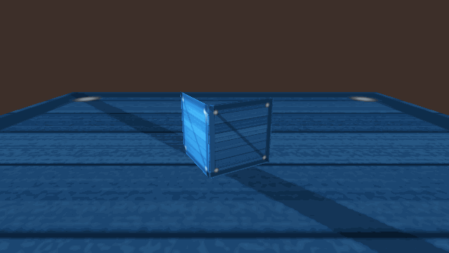
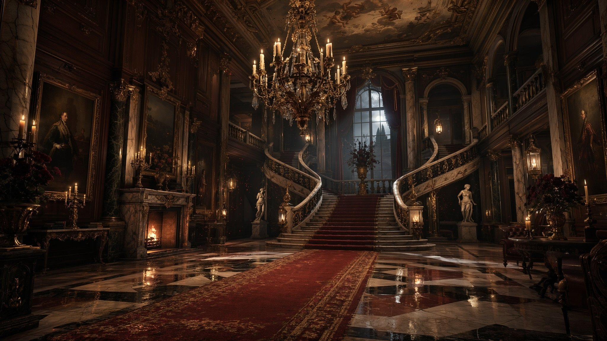
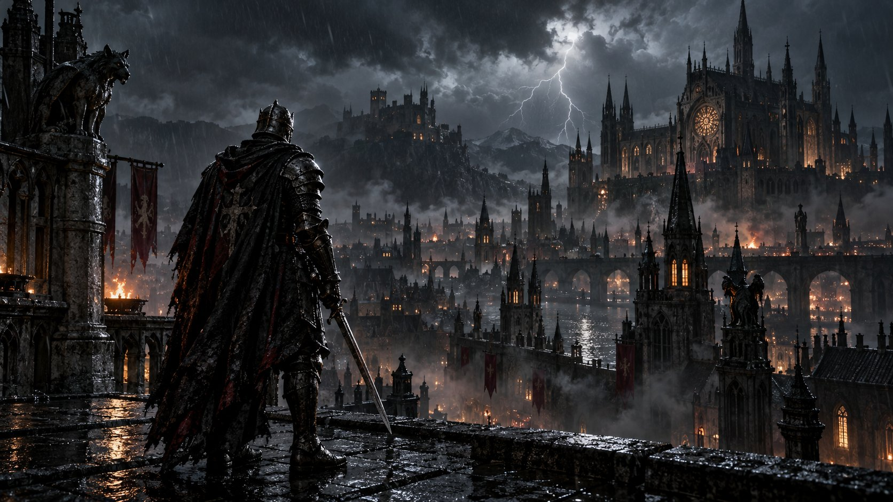

<p align="center">
  
</p>

<h1 align="center">RavenEngine</h1>

<p align="center">
  <em>A low-resource-focused C++20 Vulkan game engine — AAA ambitions on everyday hardware.</em><br>
  
  
  
</p>

<p align="center"><br>
<em>RavenEngine splash artwork (concept). In-splash-screen wiring is pending engine startup UI work.</em></p>

---

## What it is

RavenEngine is a **low-resource-focused C++20 Vulkan game engine and editor** targeting
integrated GPUs: no bloat, deterministic engine services, and a renderer that keeps frame
budgets tight.

Design goal, in one line: **a AAA look at 1920×1080 and 2560×1440, 60/120 FPS** — via render
scale, tiered quality, distance LOD and aggressive budget discipline, not by demanding 4K
enthusiast hardware.

## Current state — rendered by the engine, not concept art

<table>
<tr>
<td align="center"></td>
<td>
  <strong>Live render, right now.</strong><br>
  The sample scene drawn by <code>raven_render</code> on a Vulkan 1.3 device with dynamic
  rendering + synchronization2: PBR-ish forward pass, one directional shadow (1024²),
  warm point light, tangent-space normal map.<br><br>
  Captured locally on <strong>SwiftShader</strong> (Google's CPU Vulkan) — the same path
  CI runs on Linux with Lavapipe.
</td>
</tr>
</table>

<p align="center"><br>
<em>Orbit of the sample scene — 24 frames captured offscreen by the engine itself (SwiftShader, CPU Vulkan). This is the current look: working forward renderer, real shadows, real assets. It is also genuinely far from the target aesthetic — see below.</em></p>

## Target aesthetic — concept art, not engine output

<p align="center">
  
  
</p>
<p align="center"><em>The look RavenEngine is engineering toward (AI concept art). Achieving it needs the feature roadmap below — it is not what the engine renders today.</em></p>

## What's implemented (and tested)

- **C++20 + Vulkan 1.3** — dynamic rendering, synchronization2; no legacy paths.
- **Render graph** — passes declare reads/writes; validation rejects forward-referenced resources; barriers solved for you.
- **ECS** — sparse-set world, stable entity handles, views, hierarchy.
- **Asset pipeline** — UUID-addressed assets, `.meta` sidecars, import settings (sRGB/mipmaps), deterministic DB; OBJ/texture/scene importers; sample project included.
- **Scene format** — JSON scenes, deterministic load (`sample/scenes/sample_scene.ravenscene`).
- **Renderer** — forward PBR-ish shading, PCF shadows, offscreen target, swapchain present, ImGui texture hooks ready, frame stats with per-pass GPU timings.
- **Camera**, **rigid-body physics**, **Lua 5.4 scripting**, **miniaudio** 3D audio, **ImGui (docking) + ImGuizmo** vendored for the editor.
- **Quality tiers** (`Quality.h`) — Low/Medium/High/Ultra presets (render scale, shadow size, MSAA, texture/aniso caps, light/particle/voice budgets, physics tick + sleep distance, LOD bias) with a unit-tested LOD projection model.
- **CI** — Linux (Lavapipe offscreen render + CycloneDX SBOM artifact), Windows (MSVC), macOS (MoltenVK), all green; `v0.1.0` tagged; binary snapshot in `dist/`.

Tests: **52 core suites + 1 Vulkan smoke test** (53 total; the GPU smoke tests require a Vulkan device — CI runs them on Lavapipe, locally on SwiftShader).

## What's *not* done yet (the honest list)

- SSAO/SSR/TAA/bloom/upscale: shipped as real GPU passes with per-tier gates (MSAA/SSAO/TAA/SSR/bloom/upscale), not just a cost model.
- LOD selection is implemented, unit-tested, serialized in scenes, and consumed by the draw path (per-tier LOD bias + max distance).
- Render-scale upscaling is the engine's supported path (config + resolve contract in docs); no vendored FSR/DLSS.
- `raven-sandbox` still needs a manual orbit to look at the scene interactively; `RavenEditor` is functional but young (see below).
- **The engine does not yet look like the reference the project is dreaming about** (path-traced AAA interiors). Closing that gap is the feature roadmap — see `docs/PERFORMANCE.md` for the budget math on how to get there on low-end hardware.

## Headless Vulkan on any machine (SwiftShader)

No GPU? CI proves the render path on Lavapipe; locally you can do the same with SwiftShader —
see **[docs/BUILDING.md § CPU Vulkan via SwiftShader](docs/BUILDING.md)**.

## Repository layout

| Path          | Contents                                                             |
| ------------- | ------------------------------------------------------------------- |
| `engine/`     | `raven_core` (renderer-agnostic) + `raven_render` (Vulkan 1.3)      |
| `editor/`     | `ravened` — docking editor: hierarchy/inspector/viewport/console/profiler/assets |
| `sandbox/`    | `raven-sandbox` — minimal runnable app (windowed + offscreen smoke run)  |
| `sample/`     | Sample project: crate mesh, PBR materials, scene, Lua script, audio |
| `assets/`     | Engine assets: GLSL + compiled `.spv`                               |
| `docs/`       | BUILDING, PERFORMANCE (budget math), SECURITY (SBOM audits)         |
| `docs/media/` | Logo, splash, concept art (labeled) — renders above                 |
| `dist/`       | Linux x86_64 binary snapshot of v0.1.0                              |
| `tests/`      | Self-contained test framework + suites (`raven_tests`)               |
| `third_party/`| Vendored, version-pinned deps (`manifest.json`)                     |

## Performance targets

Quality tiers and a frame-time model for **1080p/1440p @ 60/120 FPS**:
[docs/PERFORMANCE.md](docs/PERFORMANCE.md) — re-derivable with `python3 scripts/perf_budget.py`.

Headline: Medium tier (720p-class internal upscaling) passes 1080p60 and 1440p60 on
Iris Xe-class iGPUs; 1440p120 needs ~0.75 render scale or dGPU silicon. Native 1440p120
on iGPU is not mathematically viable at 7.08 ms — see the doc for the derivation.

## Building

See **[docs/BUILDING.md](docs/BUILDING.md)** (Linux/Windows/macOS + CPU-Vulkan SwiftShader).

```sh
cmake -S . -B build -DCMAKE_BUILD_TYPE=Release -DRAVEN_BUILD_TESTS=ON
cmake --build build -j"$(nproc)"
./build/bin/raven_tests
```

The engine configures and builds **without** system Vulkan or windowing libraries —
`raven_render` and the GUI apps are skipped, and the core test suite still runs.

## License

MIT — see [LICENSE](LICENSE). Vendored third-party licenses: `third_party/manifest.json`.
